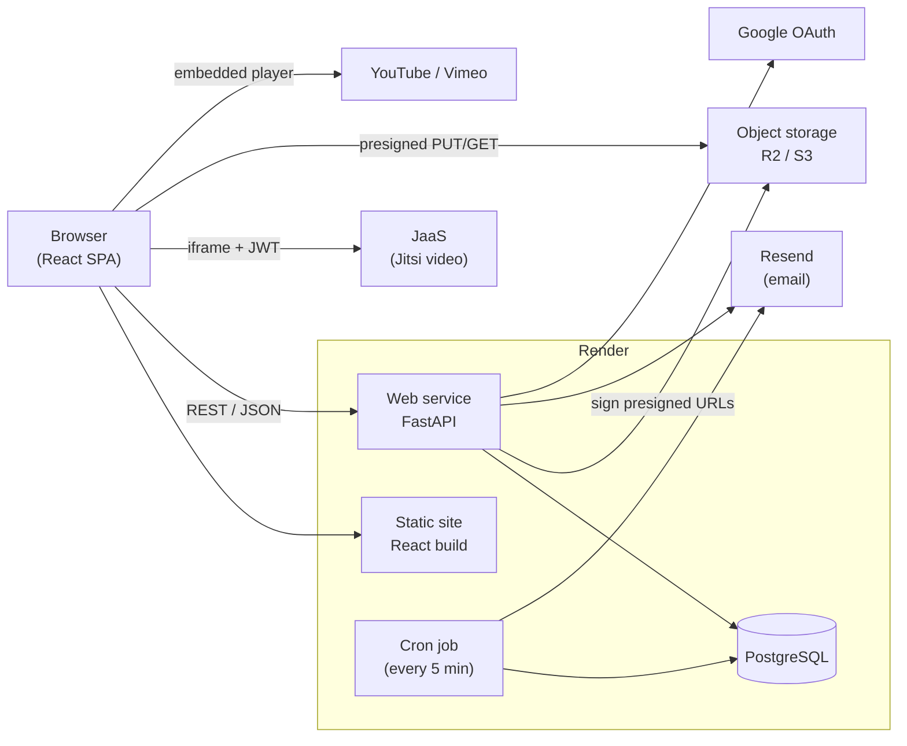
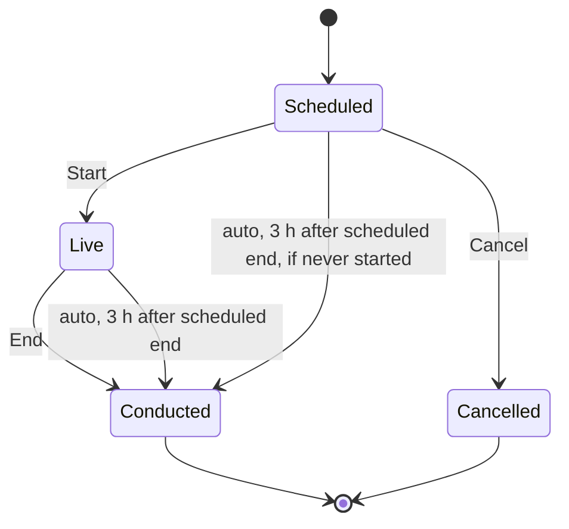
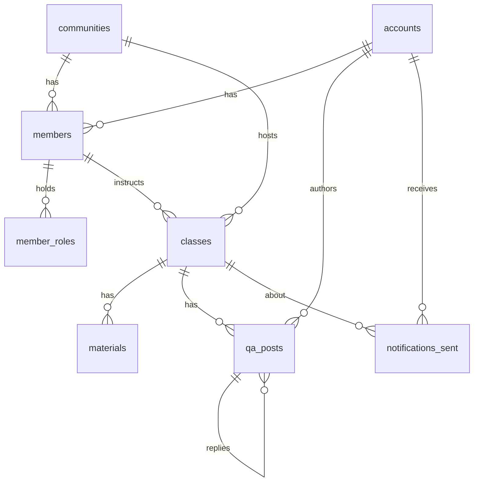

# Technical design: Live Classes for Buddhist Communities

Status: final · Implements: [spec.md](./spec.md) · Vocabulary: [GLOSSARY.md](../../GLOSSARY.md)

## 1. System architecture

### Components

| Component | Responsibility |
|---|---|
| **React SPA** (Render static site) | All UI. Talks only to the FastAPI API, plus direct uploads/downloads to object storage, the Jitsi iframe, and the Recording player. |
| **FastAPI** (Render web service) | REST API, authentication, permission checks, issuing JaaS JWTs and presigned storage URLs, sending transactional email. |
| **Cron job** (Render cron) | Every 5 minutes: auto-mark Classes Conducted after their grace period, send 24 h and 1 h reminders. Idempotent via `notifications_sent`. |
| **PostgreSQL** (Render managed) | All application data and full-text search. Daily backups, 7-day retention. |
| **JaaS** | Live video. The browser joins with a short-lived JWT from the API; the JWT carries the moderator flag. |
| **R2 / S3** | Materials files. Private bucket; access only through presigned URLs. |
| **Resend** | Invite, Class, reminder and Q&A-answer emails. |
| **Google OAuth** | Optional sign-in method alongside email and password. |

### Key flows

**Authentication.** Email and password (argon2 hash) or Google sign-in. The API issues a session as an httpOnly, secure cookie. Every endpoint under `/communities/{id}/…` loads the caller's Member record for that Community and checks its Roles. No Member record means 404, so the Community's existence isn't revealed.

**Joining by Invite link.** `/join/{invite_token}` → log in or sign up → create a Member with the Attendee Role. Its status is `active`, or `pending` if the Community requires approval. Resetting the link replaces `invite_token`, so the old link stops working.

**Joining a live Class.** The Class page calls `POST /classes/{id}/join`. The API checks membership and that the Class is Live (Instructors and Class coordinators may also join while it's Scheduled, to prepare). It returns a JaaS JWT for that Class's room, valid for 2 hours, with `moderator=true` for Instructors, Class coordinators and Community admins. The React app mounts the Jitsi iframe with the JWT. Because JaaS rooms require a valid JWT, a leaked room name is useless.

**Uploading Materials.** The client asks the API for an upload URL, sending the file name, type and size. The API validates the type and checks the size is at most 100 MB, then returns a presigned PUT URL valid for 10 minutes. The client uploads directly to storage, then confirms, and the API creates the `materials` row. Downloads use a presigned GET URL valid for 5 minutes, issued after a membership check.

**Class lifecycle.**

A Class that was never started still becomes Conducted, because it may have been taught without anyone pressing Start. A coordinator can cancel it by hand instead.

**Search.** PostgreSQL full-text search. `tsvector` columns with GIN indexes on Classes (title and description), Materials (title) and Q&A posts (body). One query combines all three, always filtered by `community_id`. This meets the under-1-second target comfortably at v1 scale.

**Account deletion.** The Account is anonymized: email and name are cleared, `deleted_at` is set, and the Google ID and password hash are removed. Q&A posts keep `author_account_id` and render as "deleted user". Member records are marked `removed`.

## 2. Database design

All primary keys are UUIDs, and all timestamps are `timestamptz` stored in UTC. Every table also has `created_at`, and `updated_at` where rows change.

### accounts
| Column | Type | Notes |
|---|---|---|
| id | uuid PK | |
| email | citext, unique, nullable | Nulled on deletion |
| display_name | text | |
| password_hash | text, nullable | Null for Google-only accounts |
| google_sub | text, unique, nullable | Google account ID |
| is_platform_admin | bool, default false | |
| reminders_enabled | bool, default true | Member opt-out of reminders |
| timezone | text, nullable | IANA name; otherwise the browser's time zone is used |
| deleted_at | timestamptz, nullable | |

### communities
| Column | Type | Notes |
|---|---|---|
| id | uuid PK | |
| name | text | |
| description | text | |
| contact_name, contact_email | text | |
| location | text | |
| status | enum `pending`, `approved`, `rejected`, `suspended` | |
| rejection_reason | text, nullable | |
| invite_token | text, unique | Random; replaced on reset |
| join_requires_approval | bool, default false | |
| created_by_account_id | uuid FK → accounts | |

### members
| Column | Type | Notes |
|---|---|---|
| id | uuid PK | |
| community_id | uuid FK → communities | |
| account_id | uuid FK → accounts | |
| status | enum `pending`, `active`, `removed` | |
| joined_at | timestamptz | |
| | | **unique** (community_id, account_id) |

### member_roles
| Column | Type | Notes |
|---|---|---|
| member_id | uuid FK → members | |
| role | enum `community_admin`, `instructor`, `class_coordinator`, `attendee` | |
| | | **PK** (member_id, role) |

### classes
| Column | Type | Notes |
|---|---|---|
| id | uuid PK | |
| community_id | uuid FK → communities | Indexed with `starts_at` |
| title | text | |
| description | text | |
| instructor_member_id | uuid FK → members | Shown in lists; filterable |
| created_by_member_id | uuid FK → members | |
| starts_at | timestamptz | |
| duration_minutes | int, check > 0 | |
| status | enum `scheduled`, `live`, `conducted`, `cancelled` | |
| started_at, ended_at, cancelled_at | timestamptz, nullable | |
| jitsi_room | text, unique | Random, not guessable |
| recording_url | text, nullable | YouTube or Vimeo URL; validated on save |
| search_vector | tsvector, generated | GIN index |

### materials
| Column | Type | Notes |
|---|---|---|
| id | uuid PK | |
| class_id | uuid FK → classes | |
| kind | enum `file`, `link` | |
| title | text | |
| storage_key | text, nullable | For `file` |
| url | text, nullable | For `link` |
| content_type | text, nullable | PDF, PPT/PPTX or image types |
| size_bytes | bigint, nullable, check ≤ 104857600 | |
| uploaded_by_member_id | uuid FK → members | |
| search_vector | tsvector, generated | GIN index |

### qa_posts
| Column | Type | Notes |
|---|---|---|
| id | uuid PK | |
| class_id | uuid FK → classes | |
| parent_id | uuid FK → qa_posts, nullable | Null means a question; otherwise a reply |
| author_account_id | uuid FK → accounts | Shown as "deleted user" if the Account is deleted |
| body | text | |
| edited_at | timestamptz, nullable | |
| deleted_at | timestamptz, nullable | Soft delete by moderators |
| search_vector | tsvector, generated | GIN index |

Whether a reply is marked as an Instructor answer is computed at read time from the author's Roles in that Community, not stored.

### notifications_sent
| Column | Type | Notes |
|---|---|---|
| id | uuid PK | |
| class_id | uuid FK → classes | |
| account_id | uuid FK → accounts | |
| kind | enum `scheduled`, `rescheduled`, `cancelled`, `reminder_24h`, `reminder_1h`, `qa_answered` | |
| ref_id | uuid, nullable | The question, for `qa_answered` |
| sent_at | timestamptz | |
| | | **unique** (class_id, account_id, kind, ref_id) |

This table makes reminders idempotent: the cron job can rerun safely without sending duplicates. For `rescheduled`, delete the earlier reminder rows so the new times trigger fresh reminders.

## 3. Decisions

- A Class never started becomes **Conducted** automatically, not Cancelled.
- Grace period before auto-Conducted: **3 hours** after the scheduled end.
- The JaaS JWT signing key lives in **Render environment variables** for v1.

## 4. Open technical questions

None outstanding.
